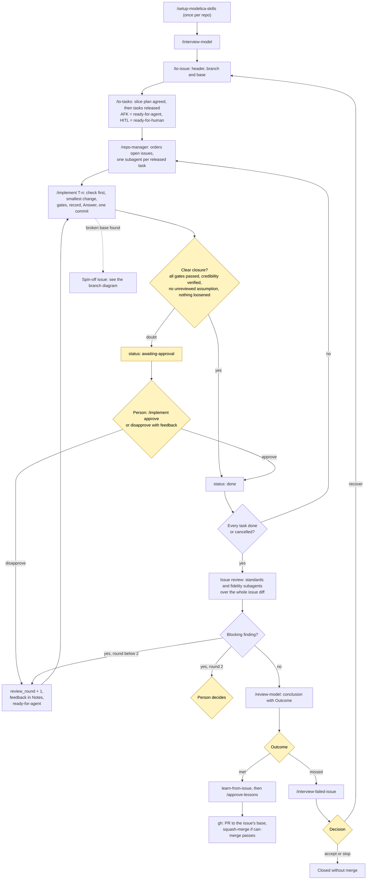
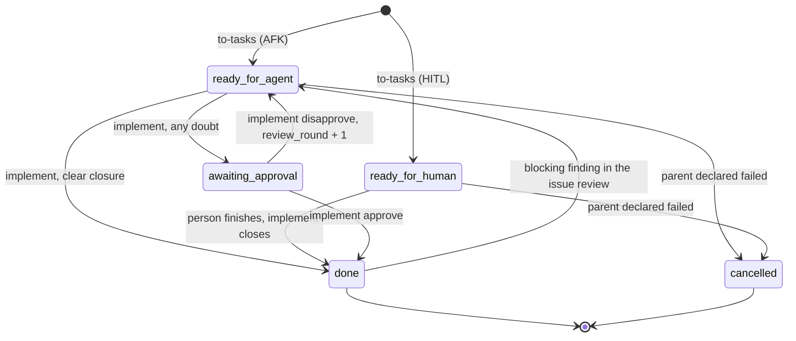
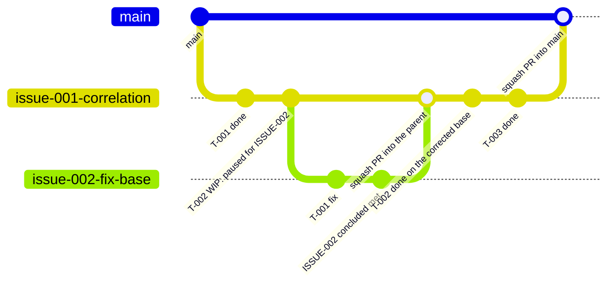

# modelica-skills

Skills for AI coding agents that build Modelica models you can trust: they follow the standard, they run, and they agree with the literature.

> Status: **Tested with OpenModelica.** The verification gates run against an OpenModelica engine (local or containerized) with support for static and simulation-backed gate evaluation. The skills learn from the library after each issue, with the owner's approval.

## Why

A model can compile, simulate and close its energy balance and still be physically wrong. These skills add the missing steps: agree the physics first, tie every correlation to a source that was really checked, run checks that can fail, and keep a record that says no more than the evidence.

## How it works

Question session → issue → tasks → build one task at a time (check first, the task closes with its Answer) → one review and conclusion per issue. Each stage ends with a quick consistency check. See [docs/flow.md](docs/flow.md).

### Workflow

Yellow boxes are decisions that stay with a person. `/repo-manager` only coordinates: each phase is a subagent that follows the skill file, and closing a task happens inside `implement`.



Task status, in the task header (`ready-for-agent` and `ready-for-human` are set by `/to-tasks`; `done`, `awaiting-approval` and the return to `ready-for-agent` only by `implement`):



One branch per issue, one commit per task, squash-merged. An issue found while building another starts from the parent's latest commit; the parent is paused until the spin-off concludes `met`, or the owner decides:



If the spin-off concludes `missed`, the parent stays paused and the person chooses: **(a)** proceed on the uncorrected base (`proceeds_without` with owner and reason in the parent header), or **(b)** declare the parent failed (its open tasks become `cancelled` and the conclusion says `missed`). A recovery issue (after a `missed` conclusion) starts from the failed issue's branch; the failed PR is closed unmerged and the recovery PR targets `main`.

Two levels of use: **L0** rough comparison, **L1** design decision. Safety-critical use (L2) is out of scope.

## Learning from the library

The skills learn from the library they are used on, once per issue, and only with the owner's approval ([ADR-0018](docs/adr/0018-issue-end-learner-with-approval.md)).

1. When an issue is concluded (`docs/issues/<id>-conclusion.md` exists), [learn-from-issue](skills/modelling/learn-from-issue/SKILL.md) collects evidence from the issue (conclusion, commits, accepted gaps) and proposes at most three candidates: a note on a skill, a new library skill, or a generic proposal for this repository. The default answer is "nothing to save". Guards removed or tolerances loosened during the issue are raised as owner flags, never as lessons.
2. [approve-lessons](skills/modelling/approve-lessons/SKILL.md) shows each candidate to a person, who approves, edits or rejects it. Only then does it enter the library: a line in `.modelica-skills/learned/<skill>.md`, or a skill in `.claude/skills/` of the library repository. Every step is in an append-only ledger (`python3 tools/mllearn.py verify` checks it).
3. **Stream A** (this repository's `skills/`) is never written by the learner. A universal lesson becomes a text proposal, checked for names of the library, which a person carries here as a pull request. **Stream B** (the overlay) is tracked in the library's own repository and is git-ignored here.

## Skills

You run these:

- [startsession](skills/modelling/startsession/SKILL.md): start here; shows where the work stands and suggests the next command.
- [setup-modelica-skills](skills/modelling/setup-modelica-skills/SKILL.md): once per repo; picks the simulation MCP server and where things live.
- [interview-model](skills/modelling/interview-model/SKILL.md): questions that fix use, physics, ranges and sources.
- [to-issue](skills/modelling/to-issue/SKILL.md): turn the conversation into an issue.
- [to-tasks](skills/modelling/to-tasks/SKILL.md): split the issue into vertical slices, one behaviour each.
- [interview-failed-issue](skills/modelling/interview-failed-issue/SKILL.md): diagnose a closed issue that missed its target; ends in recover, accept or stop.
- [implement](skills/modelling/implement/SKILL.md): build a task, check first.
- [repo-manager](skills/modelling/repo-manager/SKILL.md): keep order across open issues and drive them with one subagent per task, a branch per issue and stacked PRs.
- [review-model](skills/modelling/review-model/SKILL.md): independent review of an issue, then its conclusion (the repo manager has subagents run it when the last task closes).
- [calibrate](skills/modelling/calibrate/SKILL.md): fit parameters without fooling yourself.
- [approve-lessons](skills/modelling/approve-lessons/SKILL.md): approve, edit or reject what the learner proposed.

The agent uses these when needed:

- [verify-physics](skills/modelling/verify-physics/SKILL.md): the checks G1-G10 and what status they allow.
- [cite-source](skills/modelling/cite-source/SKILL.md): register a source and check the transcription.
- [credibility-record](skills/modelling/credibility-record/SKILL.md): the record that travels with a model.
- [model-design](skills/modelling/model-design/SKILL.md): how to write the Modelica.
- [diagnosing-simulation](skills/modelling/diagnosing-simulation/SKILL.md): when a model will not run or is wrong.
- [learn-from-issue](skills/modelling/learn-from-issue/SKILL.md): after an issue's conclusion, propose lessons for the library.

Shared: [interviewing](skills/productivity/interviewing/SKILL.md).

## Engine

Skills call an engine or MCP server to load, check, simulate and read results. `/setup-modelica-skills` asks which server/engine and maps its tools in `.modelica-skills/config.yml`. Without one, the repo runs in static-only mode.

## Installation & CLI Setup

`modelica-skills` works across AI coding agent CLIs and integrates with OpenModelica (`omc`) for full DAE compilation, unit checking and simulation.

### 1. Prerequisites
- **Python**: 3.10+
- **Dependencies**: `pip install pyyaml`

### 2. AI Coding Agent CLIs

#### Claude Code (`claude`) — plugin (recommended)
Installs the 13 skills **and** the `modelica` MCP server (engine, gates, record check) in one step. Needs [`uv`](https://docs.astral.sh/uv/) for the server.
```bash
claude plugin marketplace add faveric/faveric-modelica-skills
claude plugin install modelica-skills@faveric-modelica-skills
```
Skills are namespaced: `/modelica-skills:setup-modelica-skills`, `/modelica-skills:implement`, ... Not yet in Anthropic's `claude-plugins-official` directory (that needs a submission; the name is reserved).

The server exposes `engine_status`, `check_model`, `simulate`, `run_gates`, `check_record`. It drives OpenModelica (see section 3); the gate runner drives OpenModelica or, with `engine.backend: dymola`, Dymola through `evals/adapters/dymola.py` ([ADR-0017](docs/adr/0017-accepted-gaps-dymola-adapter-and-kept-results.md)). Without an engine, gates that need one report `skip`, and an engine result already in the record for unchanged files is kept.

A second server, `dymola`, exposes `list_available_packages`, `translate_model` and `run_simulation` through Dymola's Python interface ([ADR-0016](docs/adr/0016-dymola-mcp-server.md)). It needs a Dymola install; set `DYMOLA_PATH`, `DYMOLA_PACKAGES` (`;`-separated absolute `package.mo` paths), and optionally `DYMOLA_COMMANDS` (`|`-separated), `DYMOLA_BASEDIR`, `DYMOLA_TEMPDIR` in the environment that starts Claude Code. The gate runner calls its functions in-process for the Dymola gates; the adapter has not been run against a real Dymola yet.

#### Claude Code — manual copy (skills only, no MCP server)
Install the skills into your target Modelica library repository or globally:
- **Repository-level**:
  Copy or symlink `skills/` into `.claude/skills/` in your Modelica repository:
  ```bash
  mkdir -p .claude/skills
  cp -r /path/to/modelica-skills/skills/* .claude/skills/
  ```
- **Global**:
  ```bash
  mkdir -p ~/.claude/skills
  cp -r /path/to/modelica-skills/skills/* ~/.claude/skills/
  ```
- **Local plugin checkout** (skills + MCP server, for development):
  ```bash
  claude plugin marketplace add /path/to/faveric-modelica-skills
  claude plugin install modelica-skills@faveric-modelica-skills
  ```
  A manual copy has no gates: the skills call `run_gates`/`check_record`, which exist only through the server or the CLI inside this repo.

#### Google Antigravity (`agy` / IDE)
- **Workspace-level**:
  ```bash
  mkdir -p .gemini/antigravity/skills
  cp -r /path/to/modelica-skills/skills/* .gemini/antigravity/skills/
  ```
- **Global**:
  - Linux/macOS: `cp -r /path/to/modelica-skills/skills/* ~/.gemini/antigravity/skills/`
  - Windows (PowerShell): `Copy-Item -Recurse \path\to\modelica-skills\skills\* $HOME\.gemini\antigravity\skills\`
- Invoke commands directly in chat via `/setup-modelica-skills`, `/interview-model`, etc.

### 3. OpenModelica Engine (`omc`)

To enable simulation-backed gates (G1 `buildModel`, G2 `--unitChecking`, G3 energy balance, G5 mathematical envelope, G6a ideal bound):

- **Docker (cross-platform, recommended)**:
  ```bash
  docker run -d --name omc openmodelica/openmodelica:v1.24.4-minimal tail -f /dev/null
  ```
  The adapter auto-detects running OpenModelica containers, or set `export OMC_DOCKER_CONTAINER=omc`.

- **Local installation**:
  - **Ubuntu/Debian**:
    ```bash
    sudo add-apt-repository ppa:openmodelica/openmodelica-stable
    sudo apt-get update && sudo apt-get install openmodelica
    ```
  - **Windows**: Install via the official [OpenModelica installer](https://openmodelica.org/). The adapter automatically finds `omc.exe` in `PATH` or standard installation folders (`C:\Program Files\OpenModelica*`).
  - **macOS**: `sudo port install openmodelica` or via Homebrew.
  - Custom binary path: `export OMC_PATH=/path/to/omc`.

### 4. Setup in a Target Library

Once installed, open your target Modelica library repository in your agent CLI and run:
```bash
/setup-modelica-skills      # plugin install: /modelica-skills:setup-modelica-skills
```
This generates `.modelica-skills/config.yml` and the local `.modelica-skills/learned/` overlay folder that the learner fills after each issue (with your approval).

## Try it

Verify base skills, line budgets, and test suite:
```bash
python3 tools/lint_skills.py
python3 -m unittest discover -s evals/tests -t .
```

Run verification gates on a target model or library:
```bash
# Static checks:
python3 evals/run_gates.py /path/to/model-directory

# Simulation-backed checks with OpenModelica engine:
python3 evals/run_gates.py /path/to/model-directory --engine omc
```

More in [AGENTS.md](AGENTS.md), [GLOSSARY.md](GLOSSARY.md) and [docs/](docs/).

## Licence

MIT, see [LICENSE](LICENSE).
